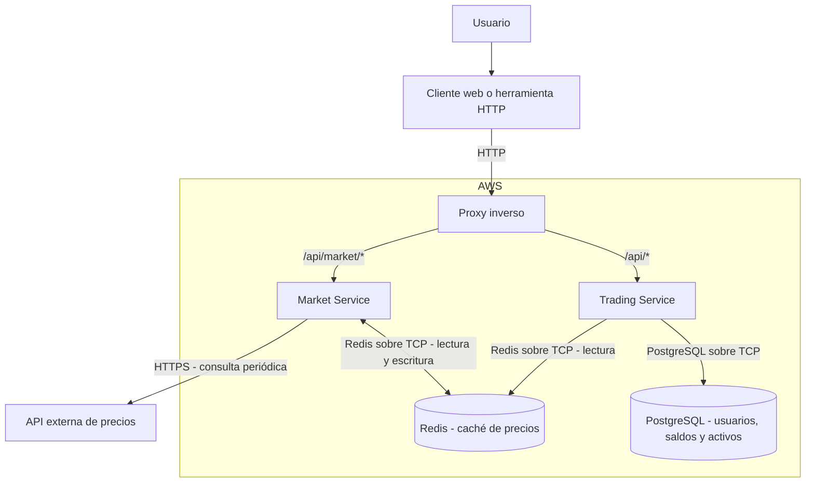

# Simulador de Trading de Criptomonedas

## 1. Descripción del proyecto

El proyecto consistirá en el desarrollo una aplicación web que permite simular la compra y venta de criptomonedas utilizando dinero virtual, donde se podrá consultar los precios de cada moneda. La aplicación obtendrá los precios de las criptomonedas periodicamente a través de una API externa y calculará el valor de los activos del usuario (si los tuviera) en función de los precios actuales. El usuario podrá consultar en su cartera virtual los activos que posee y sus respectivos valores. 

## 2. Descripción del Dominio

## 2.1 Problema de negocio

El mercado de las criptomonedas es vólatil y recibe cambios constantes: los precios de las monedas suben y bajan en periodos de tiempo relativamente cortos. También, el proceso de aprendizaje requiere dinero real lo cual supone un riesgo económico especialmente para principiantes que carecen de experiencia previa e desean integrarse en el mundo de trading de criptomonedas. 

Por este motivo, se propone diseñar y desarrollar una aplicación web que permite simular el trading de las criptomonedas es decir, la compra y venta de activos digitales (Bitcoin, Ethereum etc) sin utilizar dinero real. La aplicación permitirá gestionar una cartera virtual, con dinero ficticio además de consultar los precios de las criptomonedas y realizar operaciones simuladas de compra y venta. De esta forma, los usuarios podrán observar como cambian sus inversiones virtuales en función de la variación de los precios del mercado sin asumir riesgos económicos.

## 2.2 Casos de uso principales

**CU01 - Consultar criptomonedas.** El usuario visualiza las criptomonedas disponibles y sus precios actuales, junto con la hora de su última actualización. Los precios se sirven desde una caché compartida alimentada por una API externa.

**CU02 - Comprar activo.** El usuario compra una cantidad de una criptomoneda al precio actual si dispone de saldo suficiente. La operación descuenta el saldo, recalcula el precio medio de compra y aumenta la cantidad poseída.

**CU03 - Vender activo.** El usuario vende la cantidad deseada de criptomonedas en su posesión. La operación incrementa el saldo, reduce la cantidad que tiene y se registra la ganancia o pérdida realizada.

**CU04 - Registrarse e iniciar sesión.** Los usuarios nuevos crean una cuenta con nombre de usuario y contraseña, y los registrados inician sesión para acceder a su cartera. Todos los usuarios reciben un saldo virtual de 10,000 EUR.

**CU05 - Consultar cartera.** El usuario consulta su saldo y sus activos. Para cada activo se calcula el precio medio de compra, el valor actual y la ganancia o pérdida (absoluta y porcentual), además del valor total de la cartera.

**CU06 - Recargar saldo.** El usuario puede añadir saldo virtual cuando el suyo sea inferior a 100 EUR. Como máximo puede recargar hasta 10,000 EUR.

**CU07 - Actualizar precios (sistema).** El Market Service consulta periódicamente la API externa y actualiza la caché compartida. El market service leerá de esta caché para proporcionar esa información a los usuarios mientras que el Trading service lo utilizará para obtener los precios necesarios para simular las operaciones compra y venta.

## 3. Características Cloud según NIST SP 800-145 y Justificación del uso de la nube

### 3.1 Autoservicio bajo demanda

Para mi aplicación de simulación de trading de criptomonedas, el autoservicio bajo demanda permitirá aprovisionar y configurar los recursos necesarios para desplegar la aplicación sin intervención directa del proveedor. En concreto, el simulador requiere aprovisionar recursos como máquinas virtuales (para la ejecución de microservicios en contenedores), una base de datos, una caché (Redis para la consulta de precios) y la red. Se crearán estos recursos de forma automática mediante infraestructura como código (IaC) con Terraform.

### 3.2 Acceso amplio a la red

El simulador es una aplicación web accesible mediante internet que permite a los usuarios consultar los precios de las criptomonedas, gestionar sus activos y la cartera virtual desde varias dispositivos con conexión a la red. La plataforma expone su funcionalidad a través de una API REST sobre HTTP con respuestas en JSON, un mecanismo estandarizado, permitiendo que los usuarios pueden realizar operaciones desde navegadores web, dispositivos móviles siempre que tengan acceso a internet. 

### 3.3 Agrupación de recursos

La infraestructura cloud escogida para desplegar la aplicación proporcionará los recursos necesarios para poner en marcha los microservicios y almacenar los datos del simulador de trading de criptomonedas. Estos recursos forman parte de la infraestructura compartida entre múltiples consumidores. Donde la asignación y reasignación de recurosos será gestionado por el proveedor cloud en función de la demanda. Con esto se consigue que la aplicación aproveche los recursos ofrecidos por esta infraestructura sin tener que obtener servidores físicos propios.

### 3.4 Rápida elasticidad

El mercado podría sufrir fluctuaciones en los precios de las criptomonedas que podrían causar variaciones en la actividad de los usuarios del simulador y por tanto, podría aumentar la demanda de recursos computacionales. Por este motivo, la aplicación aprovecha la rápida elasticidad para aumentar la capacidad de la infraestructura cuando haya un elevado número de usuarios realizando operaciones así como reducirla cuando la demanda disminuya.

### 3.5 Servicio medido

La plataforma aprovechará el servicio medido para monitorizar el consumo de recursos además de las peticiones recibidas y tiempos de respuesta. En concreto, se podrá monitorizar el uso de CPU y memoria principal cuando los usuarios vayan a consultar los precios de criptomonedas, la realización de operaciones compraventa o tareas relacionadas con sus carteras virtuales. Estos datos nos darán una visión general del consumo de recursos y controlar los costes asociados al despliegue. 

### 3.6 Justificación del uso en la nube

El uso de la nube para desplegar el simulador de trading de criptomonedas se justifica por varios motivos. Una de las principales razones para utilizar una infraestructura cloud en el simulador es la posible variación de la demanda de usuarios. Como se ha mencionado en apartados previos, las fluctuaciones de los precios pueden provocar picos de actividad ya que un elevado número de usuarios podría acceder al simulador para consultar los precios del mercado o realizar la compraventa de monedas.

Por otro lado, al tratarse de una aplicación basada en microservicios, es evidente que habrá una carga asimétrica entre algunos servicios. En concreto, el servicio de consulta de precios tendrá muchisimas más peticiones que el servicio de compraventa por lo que cada servicio debe escalarse de forma distinta e independiente. Esto respalda la necesidad de aprovechar de la nube ya que algunos proveedores permiten ajustar de forma dinámica el número de instancias o la capacidad asignada.

Otro motivo por el que utilizar la infraesrtructura cloud es debido a la disponibilidad del simulador. El mercado opera de forma continua por lo que la app debe ser disponible en cualquier momento para que los usuarios puedan consultar sus activos y los precios actuales.la implementación en el cloud facilita la tolerancia a fallos, si alguna instancia falla se podrá desplegar otra de forma rápida evitando interrupciones del servicio.

## 4. Actores Cloud según NIST SP 500-292 y impacto económico

### 4.1 Actores Cloud

| Actor | Aplicación en el proyecto | Impacto económico |
|---|---|---|
| **Cloud Consumer** | El consumidor en este contexto sería el desarrollador de la plataforma que utiliza los recursos del proveedor necesarios para desplegar la aplicación.| En este caso, el impacto económico será prácticamente nulo ya que se empleará la capa gratuita de AWS respetando sus límites de uso. |
| **Cloud Provider** | El proveedor proporcionará la infraestructura y servicios de la nube necesarios para ejecutar el simulador. En este caso el proveedor de la infraestructura será AWS. | El uso del plan gratuito permitirá reducir los costes de infraestructura. Se respetarán las condiciones y límites para evitar cargos adicionales. Cabe mencionar, que el plan gratuito proporciona |
| **Cloud Broker** | En este caso, no habrá cloud broker ya que contactamos directamente con el proveedor. | Al no contratar servicios de un intermediario no habrán costes asociados. |
| **Cloud Auditor** | Este proyecto no contará con un auditor externo por lo que el desarrollador se hará responsable de realizar comprobaciones de seguridad además de asegurar el cumplimiento de RGPD y la LOPDGDD. | No habrá gastos de contratación de auditorías externas sin embargo, las comprobaciones internas requerirán la inversión de tiempo de trabajo. |
| **Cloud Carrier / Operator** | Los operadores de telecomunicaciones y proveedores de acceso a internest además de la red del proveedor permitirán transportar el tráfico entre los usuarios del simulador y la infraestuctura nube. | Se utilizará la conexión a internet ya disponible sin necesidad de contratar una conexión adicional para el proyecto. |

## 5. Arquitectura del sistema

### 5.1 Diagrama de arquitectura

A continuación se muestra el diagrama de arquitectura del sistema, con los componentes, los microservicios y los protocolos de comunicación entre ellos.

### 5.2 Componentes

El simulador será una arquitectura basado en microservicios. En concreto, estará formado por dos microservicios principales: Trading Service y Market Service. A continuación se detallan sus respectivas responsabilidades 

- Market Service: El servicio permite obtener y actualizar los precios de las criptomonedas.

- Trading Service: Este microservicio permite gestionar las compras y ventas de las criptomonedas, administra el saldo virtual de los usuarios junto con el registro e inicio de sesión.

- Base de Datos PostgreSQL: Se ha optado por utilizar una base de datos relacional por la naturaleza estructurada de los datos del problema.

- API Externa: Conectará a la aplicación y permitirá obtener los precios actuales de las criptomonedas.

- Caché Compartida: Con el fin de reducir un elevado número de peticiones a la API externa se ha optado por incluir una caché compartida para almacenar los últimos precios obtenidos para evitar sobrecargar la API externa. Esta caché se implementará mediante Redis.

- Proxy Inverso: Se encargará de enrutar las peticiones del cliente en función del prefijo de la ruta. 

### 5.3 Comunicación entre Microservicios

- Cliente y Servicios: El cliente accedrá mediante HTTP a un proxy inverso que enrutará las peticiones en función del prefijo.

- Entre microservicios: Los microservicios no se comunicarán de forma directa, es decir, el Market Service escribirá los precios en la caché y el trading service los leerá permitiendo un cierto desacoplamiento entre microservicios. 

- Caché (Redis): Market Service y Trading Service accederán a la caché compartida mediante el protocolo Redis.

-Market Service y API externa: El servicio de mercado consultará de forma periodica la API externa para obtener los precios actuales a través del protocolo HTTPS.

- Base de Datos: Trading Service accederá a la base de datos PostgreSQL a través del protocolo PostgreSQL sobre TCP. El Market Service no accederá a la base de datos porque únicamente se encargará de obtener los precios de las criptomonedas.  

